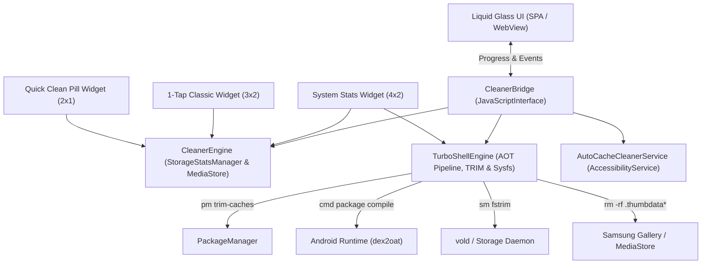

# ✨ VibeClean PRO (1Tap Cleaner)

[](https://github.com/Jeffrey2081/VibeClean)
[-3DDC84.svg?style=for-the-badge&logo=android&logoColor=white)](https://developer.android.com)
[](LICENSE)
[]()

> **100% Vibe Coded.** Engineered end-to-end with pure AI agentic pair-programming, liquid glass aesthetics, low-level Android kernel/sysfs APIs, and zero bloatware.

**VibeClean PRO** is a modern, ultra-lightweight Android utility inspired by 1Tap Cleaner. It combines liquid glassmorphism, zero-friction UI automation, deep system cache clearing, hardware-level flash TRIM, Ahead-of-Time (AOT) ART Dexopt compilation, and specialized Samsung One UI thumbnail purging.

---

## 📸 Screenshots

| Liquid Glass Dashboard | Turbo Shell & Auto-Opt | S26 Gallery Deep Purge | Widgets Suite (3 Widgets) |
|:----------------------:|:----------------------:|:----------------------:|:-------------------------:|
|  |  |  |  |

---

## ⚡ Key Features

### 1. 💎 Liquid Glass Design & Fluid Aesthetics
- **Frosted Liquid Glass**: 28px backdrop-filter blur with 200% saturation for deep cosmic reflections.
- **Specular Highlights**: Multi-layer specular glare along card edges with animated liquid sheen wave transitions.
- **Fluid Haptics**: Native vibration feedback paired with crisp, interactive micro-animations.

### 2. ⚡ 1-Tap Auto Optimize (Single-Button Pipeline)
A single prominent hero button that sequentially triggers all high-performance optimizations in one click:
1. **System Cache Trim**: `pm trim-caches 999G` across all packages without touching user logins.
2. **Flash Storage Hardware TRIM**: `sm fstrim` across UFS NAND flash partitions.
3. **Samsung Gallery & Thumbnails Deep Purge**: Completely purges `.thumbnails`, `.thumbdata*`, and MediaStore `.trashed-*` files.
4. **Storage & XML Sweeper**: Removes orphaned GCam XML configs and root crash dump files.
5. **AOT Speed-Profile Compilation**: Compiles user apps ahead-of-time with `speed-profile`.
6. **AOT Native Machine Code Compilation**: Compiles core UI components (One UI Home, System UI, Keyboard, Camera, Gallery, Google Play Services) into machine code (`speed`).
7. **RAM & Process Boost**: Flushes background cache and triggers system garbage collection.

### 3. 🖼️ Samsung Galaxy (S20-S26) & Android Gallery Thumbnail Purge
Fixes the notorious Android 11-16 scoped storage issue where thumbnail caches don't get cleared:
- Recursively scans and purges `/sdcard/DCIM/.thumbnails`, `/sdcard/Pictures/.thumbnails`, `/sdcard/Movies/.thumbnails`, and `/sdcard/Download/.thumbnails`.
- Deep-cleans massive hidden `.thumbdata3--*` and `.thumbdata4--*` index files.
- Clears Android MediaStore `.trashed-*` files (photos and videos kept in limbo consuming gigabytes).
- Automatically invokes Android `ContentResolver` to update MediaStore indexes immediately after deletion.

### 4. 🔋 True Battery Health State (Not Just Percent)
- Queries Android `BatteryManager.EXTRA_HEALTH` and Linux/Samsung sysfs nodes (`/sys/class/power_supply/battery/health`, `fg_asoc`, `battery_cycle`).
- Accurately displays the true **Battery Health condition**: **Good (Optimal)**, **Normal**, or **Overheated**, rather than confusing it with current battery charge percentage.

### 5. 📱 Multi-Widget Suite (3 Useful Home Screen Widgets)
Includes 3 distinct native Android widgets:
1. **System Stats Monitor (`4 × 2`)**: Real-time Free Storage, RAM Usage %, Battery Health (Good/Optimal), and ZRAM/Swap status with an instant `⚡ BOOST` button.
2. **1-Tap Classic Cleaner (`3 × 2`)**: Visual Storage and RAM meters with instant 1-tap background cache cleaning and haptic feedback.
3. **Quick Clean Pill (`2 × 1`)**: Minimalist liquid glass pill displaying free storage with a quick-tap BOOST action designed for clean dock setups.

### 6. 🤖 Accessibility Auto-Cleaner (Hands-Free Cache Purge)
- Built-in `AutoCacheCleanerService` automatically navigates through all installed apps.
- Opens system App Info → Storage → dynamically detects and taps **"Clear cache"** → returns back to queue the next app.

---

## 🛠️ Architecture & Under the Hood



---

## 📥 Installation

Download the latest signed APK from GitHub Releases or directly from your `Downloads` directory:

```bash
# Install via ADB:
adb install -r ~/Downloads/VibeClean_v1.0.apk
```

*(Or transfer [`VibeClean_v1.0.apk`](file:///home/jeff/Downloads/VibeClean_v1.0.apk) directly to your Android device and tap to install).*

---

## 🔨 Building from Source

Build the signed APK in under 3 seconds using standard command-line tools:

```bash
git clone https://github.com/Jeffrey2081/VibeClean.git
cd VibeClean
chmod +x build.sh
./build.sh
```

---

## 📜 License

MIT License © 2026 [Jeffrey2081](https://github.com/Jeffrey2081). 100% Vibe Coded with ❤️.
