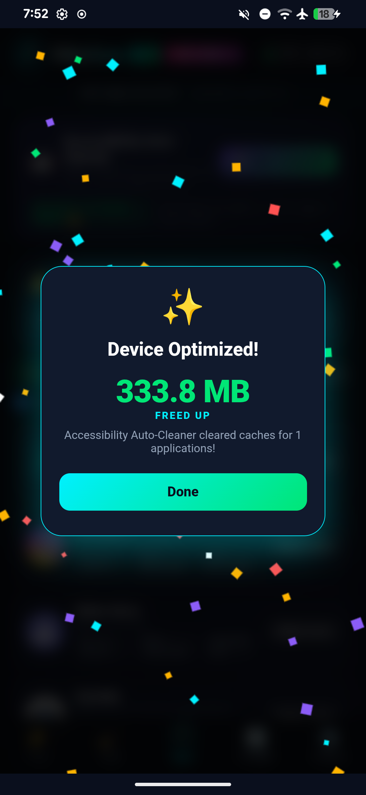
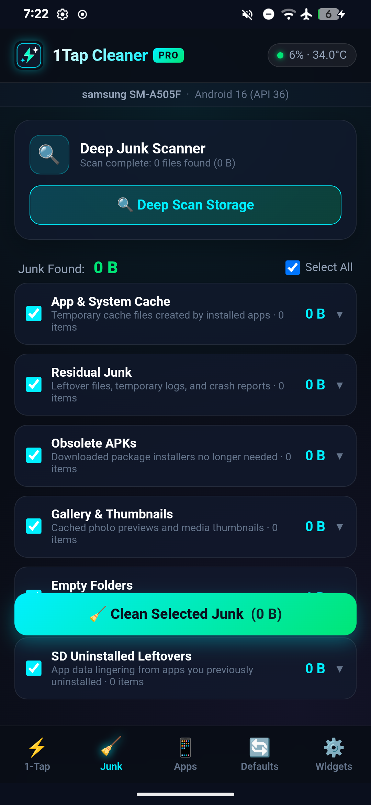
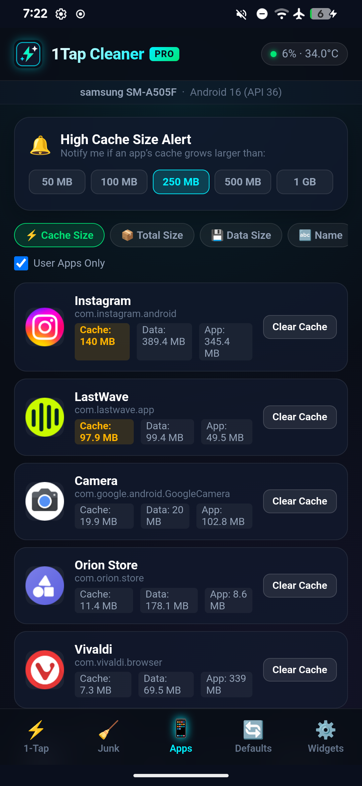
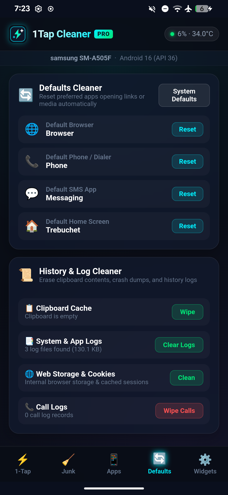
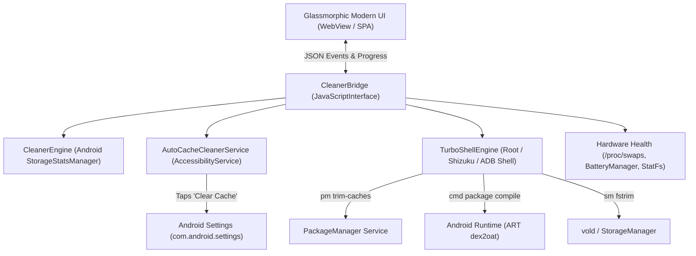

# ✨ VibeClean PRO (1Tap Cleaner)

[](https://github.com/Jeffrey2081/VibeClean)
[-3DDC84.svg?style=for-the-badge&logo=android&logoColor=white)](https://developer.android.com)
[](LICENSE)
[]()

> **100% Vibe Coded.** Engineered end-to-end with pure AI agentic pair-programming, hyper-optimized low-level Android system APIs, and zero bloatware.

**VibeClean PRO** is a modern, lightweight, glassmorphic Android utility inspired by 1Tap Cleaner. It combines zero-friction UI automation, deep system cache clearing, hardware-level flash TRIM, and Ahead-of-Time (AOT) ART Dexopt compilation to deliver maximum speed, extended battery life, and reclaimed storage.

---

## 📸 Screenshots

| Dashboard & Health | Turbo Shell & Cleaner | App Storage Manager | Defaults & System |
|:------------------:|:---------------------:|:-------------------:|:-----------------:|
|  |  |  |  |

---

## ⚡ Key Features

### 1. 🤖 Accessibility Auto-Cleaner (Hands-Free Cache Purge)
- Built-in `AutoCacheCleanerService` automatically navigates through all installed apps.
- Opens system App Info → Storage → dynamically detects and taps **"Clear cache"** → returns back to queue the next app.
- Zero manual clicking required across dozens of apps.

### 2. 🚀 Turbo Shell & Ahead-of-Time ART Compilation
- **Dexopt Optimization**: Compiles bytecode ahead of time to eliminate JIT stutter and slow app startups after OS updates.
  - Third-party apps (WhatsApp, Instagram, Snapchat, Browsers, etc.) compiled with `speed-profile`.
  - Core System & UI components (One UI Home, SystemUI, Keyboard, Camera, Gallery, Google Play Services, Settings) compiled into machine code (`speed`).
- **System-Wide Cache Trimming**: Executes `pm trim-caches 999G` across all packages, reclaiming orphaned post-upgrade cache artifacts without touching logins or app data.
- **UFS Flash TRIM (`fstrim`)**: Issues hardware TRIM (`sm fstrim`) across NAND flash partitions to clean unmapped flash blocks and restore read/write speeds.

### 3. 🔍 Hardware & Health Verification
- **Battery Health**: Reads live hardware health percentage, cycle charge estimates, and real-time battery temperatures.
- **RAM Plus & Swap Monitor**: Analyzes `/proc/swaps` and ZRAM allocation to ensure optimal physical RAM utilization without flash wear.
- **UFS Storage Analytics**: Accurate partition-level breakdown of total, used, and free flash storage.

### 4. 🧹 Storage Junk & Root XML Sweeper
- **Root XML Sweeper**: Purges orphaned camera XML configs (`cam_settings.xml`, `hdr_menu.xml`) and stray files left behind in `/sdcard/`.
- **SD & Storage Cleaner**: Scans for `.tmp`, `.log`, obsolete APK installers, and empty directories.
- **History & Log Cleaner**: Cleans clipboard, browser traces, and crash dumps.

### 5. ⚙️ App Monitoring & Defaults Manager
- **App Storage Inspector**: Sorts apps by total size, cache size, or data usage.
- **Cache Limit Alerts**: Configurable cache size thresholds (100MB, 250MB, 500MB, 1GB) with automated cleanup notifications.
- **Defaults Cleaner**: View and reset default intent handlers (browsers, media players, dialers) with one tap.

### 6. 📱 Modern Glassmorphic Widget & Background Automation
- **Home Screen Widget**: 1-Tap quick cleaning widget showing available storage and quick-clean action.
- **Automated Cleaning**: Low-storage triggers via Android `JobScheduler` and `BroadcastReceiver`.

---

## 🛠️ Architecture & Under the Hood



- **Zero Heavy Frameworks**: Ultra-compact binary (**~102 KB APK**).
- **Security-First**: Uses official public Android APIs wherever possible (`StorageStatsManager`, `AccessibilityService`, `JobScheduler`). High-performance shell operations gracefully fall back to ADB/Shizuku execution.

---

## 📥 Installation

The final signed APK is available in the repository releases and in your `Downloads` directory:

```bash
# Install via ADB:
adb install -r ~/Downloads/VibeClean_v1.0.apk

# Or download VibeClean_v1.0.apk directly on your Android device and tap to install!
```

### Granting Permissions

1. **Storage Access**: Grant All Files Access when prompted (or in Settings → Special App Access → All Files Access).
2. **Accessibility Service**: In Settings → Accessibility → Installed Apps → Turn on **VibeClean PRO - Auto Cache Cleaner**.
3. **Usage Stats**: Enable "Usage Access" so VibeClean can inspect app cache sizes without root.
4. **Shell / Shizuku (Optional for Turbo AOT)**: Run with ADB or Shizuku to unlock full `dexopt` compilation and `fstrim`.

---

## 🔨 Building from Source

No complex Android Studio installation needed. You can build the signed APK in under 5 seconds with standard command-line tools:

```bash
# Dependencies: aapt2, d8, apksigner, openjdk-21
git clone https://github.com/Jeffrey2081/VibeClean.git
cd VibeClean
chmod +x build.sh
./build.sh
```

The output APK will be generated at `dist/VibeClean_v1.0.apk`.

---

## 📜 License

MIT License © 2026 [Jeffrey2081](https://github.com/Jeffrey2081). Vibe coded with ❤️.
