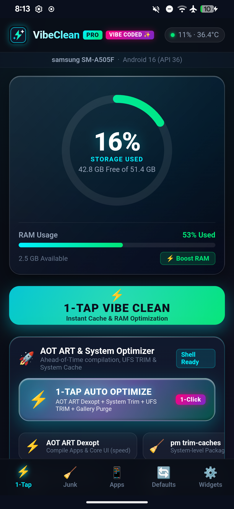
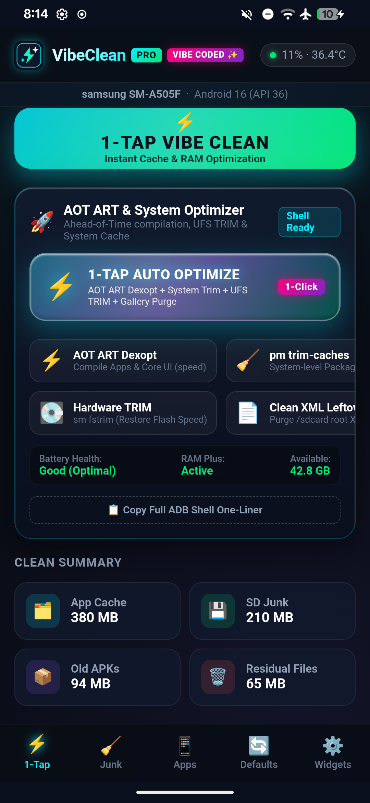
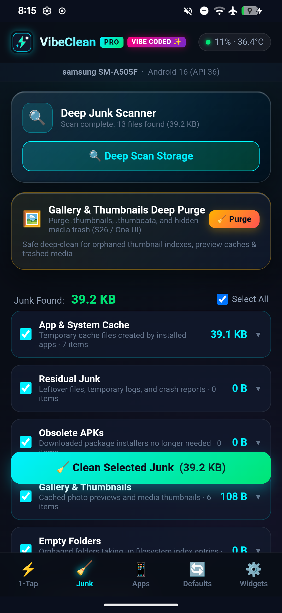
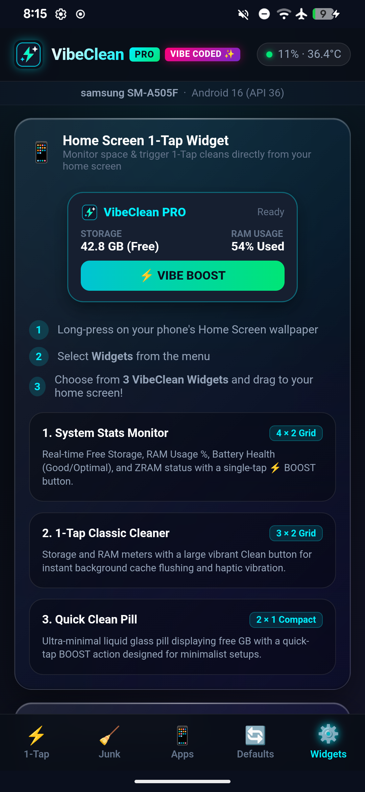
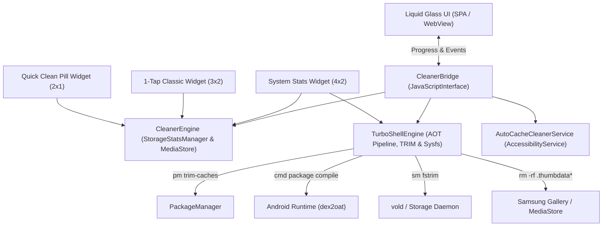

# ✨ VibeClean PRO (1Tap Cleaner)

[](https://github.com/Jeffrey2081/VibeClean)
[-3DDC84.svg?style=for-the-badge&logo=android&logoColor=white)](https://developer.android.com)
[](LICENSE)
[]()

> **100% Vibe Coded.** Engineered end-to-end with pure AI agentic pair-programming, liquid glass aesthetics, low-level Android kernel/sysfs APIs, and zero bloatware.

**VibeClean PRO** is a modern, ultra-lightweight Android utility inspired by 1Tap Cleaner. It combines liquid glassmorphism, zero-friction UI automation, deep system cache clearing, hardware-level flash TRIM, Ahead-of-Time (AOT) ART Dexopt compilation, and specialized Samsung One UI thumbnail purging.

---

## 📸 Screenshots

| Liquid Glass Dashboard | Turbo Shell & Auto-Opt | S26 Gallery Deep Purge | Widgets Suite (3 Widgets) |
|:----------------------:|:----------------------:|:----------------------:|:-------------------------:|
|  |  |  |  |

---

## ⚡ Key Features

### 1. 💎 Liquid Glass Design & Fluid Aesthetics
- **Frosted Liquid Glass**: 28px backdrop-filter blur with 200% saturation for deep cosmic reflections.
- **Specular Highlights**: Multi-layer specular glare along card edges with animated liquid sheen wave transitions.
- **Fluid Haptics**: Native vibration feedback paired with crisp, interactive micro-animations.

### 2. ⚡ 1-Tap Auto Optimize (Single-Button Pipeline)
A single prominent hero button that sequentially triggers all high-performance optimizations in one click:
1. **System Cache Trim**: `pm trim-caches 999G` across all packages without touching user logins.
2. **Flash Storage Hardware TRIM**: `sm fstrim` across UFS NAND flash partitions.
3. **Samsung Gallery & Thumbnails Deep Purge**: Completely purges `.thumbnails`, `.thumbdata*`, and MediaStore `.trashed-*` files.
4. **Storage & XML Sweeper**: Removes orphaned GCam XML configs and root crash dump files.
5. **AOT Speed-Profile Compilation**: Compiles user apps ahead-of-time with `speed-profile`.
6. **AOT Native Machine Code Compilation**: Compiles core UI components (One UI Home, System UI, Keyboard, Camera, Gallery, Google Play Services) into machine code (`speed`).
7. **RAM & Process Boost**: Flushes background cache and triggers system garbage collection.

### 3. 🖼️ Samsung Galaxy (S20-S26) & Android Gallery Thumbnail Purge & System Storage Sync
Fixes the notorious Android 11-16 scoped storage issue where thumbnail caches don't get cleared or fail to update in system settings:
- **Volume Marker Whitelisting**: Explicitly ignores un-deletable OS filesystem markers like `.database_uuid` (36 bytes) and `.nomedia` so thumbnail category sizes don't remain stuck at phantom non-zero byte values.
- **Full File Path Mapping**: Replaces truncated preview lists with complete filesystem path tracking, ensuring all thumbnails and orphan previews in `.thumbnails` folders are deleted when selected from the category dropdown or purged via dedicated action.
- **Daemon Unlock & File Truncation**: Force-stops `com.sec.android.gallery3d` and media providers so locked file descriptors on `.thumbdata` files are released; truncates active locked files to 0 bytes so they consume zero storage.
- **MediaStore Database Reconciler**: Runs SQL deletes on `content://media/external/file` and `MediaStore.Images.Media` to eliminate stale thumbnail references.
- **Instant UI Reconciliation & Rescan**: Immediately updates UI sizes to `0 B` upon cleaning and triggers `MediaScannerConnection.scanFile`, broadcasts `MEDIA_SCANNER_SCAN_FILE`, and executes `pm trim-caches 999G` so Android System and Settings -> Storage immediately recalculate and reflect the freed space!

### 4. 🔋 Granular Battery Optimization Suite (With Clear Tradeoffs & Drawbacks)
A customizable battery suite allowing users to selectively choose which optimizations to apply, complete with clear technical explanations and explicit drawbacks for each:

1. **⚡ Quick Doze Mode (Zero-Delay Deep Sleep)**: Tunes `device_idle_constants` (`quick_doze_delay_to=0`) to plunge the CPU into deep sleep immediately on screen-off (~0.2%/hr standby drain).
   - *Drawback*: Non-priority background social notifications may wait until screen-on. Calls, SMS, and alarms are never delayed.
2. **📶 Wi-Fi Background Scanning**: Stops system services and background apps from cycling Wi-Fi hardware to scan for nearby routers (`wifi_scan_always_enabled 0`).
   - *Drawback*: Indoor map positioning may take 1-2 seconds longer when GPS satellites are blocked.
3. **📡 Bluetooth LE Beacon Scanning**: Shuts off continuous low-energy Bluetooth radio beacon polling when Bluetooth is off (`ble_scan_always_enabled 0`).
   - *Drawback*: Un-paired nearby smart accessories or Quick Share popups won't show instant discovery banners until you open Bluetooth.
4. **🔋 Mobile Data Standby on Wi-Fi**: Prevents cellular modem from keeping active data links and sending packets while connected to strong Wi-Fi (`mobile_data_always_on 0`).
   - *Drawback*: Switching over to 4G/5G mobile data when walking out of Wi-Fi range takes 1-2 seconds instead of instantaneous handoff.
5. **🛑 Wakelock Shield (Social Apps)**: Sets standby buckets to `restricted` and blocks background CPU wakelocks (`WAKE_LOCK ignore`, `RUN_IN_BACKGROUND ignore`) for Instagram, Snapchat, Facebook, and TikTok.
   - *Drawback*: Social feeds and stories will not preload while your phone is locked; they refresh when you open the app.
6. **💨 Snappy UI (0.5x Animation Scale)**: Cuts window and transition animation duration in half (`0.5x`), reducing GPU rendering load, battery temperature, and frame drop.
   - *Drawback*: UI transitions are rapid and snappy rather than long, slow cinematic animations.
7. **🛡️ System Error Telemetry**: Disables automatic background packaging and cellular uploading of OS crash dumps to Google/OEM telemetry servers (`send_action_app_error 0`).
   - *Drawback*: If an application crashes, crash logs will not be automatically uploaded to OS developer analytics.
8. **🤖 AI Adaptive Battery Management**: Uses device intelligence to throttle background CPU execution for apps you haven't opened in days (`adaptive_battery_management_enabled 1`).
   - *Drawback*: Rarely-used apps will have background syncing delayed until opened.

### 5. 🔋 True Battery Health State (Not Just Percent)
- Queries Android `BatteryManager.EXTRA_HEALTH` and Linux/Samsung sysfs nodes (`/sys/class/power_supply/battery/health`, `fg_asoc`, `battery_cycle`).
- Accurately displays the true **Battery Health condition**: **Good (Optimal)**, **Normal**, or **Overheated**, rather than confusing it with current battery charge percentage.

### 6. 📱 Multi-Widget Suite (3 Useful Home Screen Widgets)
Includes 3 distinct native Android widgets:
1. **System Stats Monitor (`4 × 2`)**: Real-time Free Storage, RAM Usage %, Battery Health (Good/Optimal), and ZRAM/Swap status with an instant `⚡ BOOST` button.
2. **1-Tap Classic Cleaner (`3 × 2`)**: Visual Storage and RAM meters with instant 1-tap background cache cleaning and haptic feedback.
3. **Quick Clean Pill (`2 × 1`)**: Minimalist liquid glass pill displaying free storage with a quick-tap BOOST action designed for clean dock setups.

### 7. 🤖 Accessibility Auto-Cleaner (Hands-Free Cache Purge)
- Built-in `AutoCacheCleanerService` automatically navigates through all installed apps.
- Opens system App Info → Storage → dynamically detects and taps **"Clear cache"** → returns back to queue the next app.

---

## 🛠️ Architecture & Under the Hood



---

## 📥 Installation

Download the latest signed APK from GitHub Releases or directly from your `Downloads` directory:

```bash
# Install via ADB:
adb install -r ~/Downloads/VibeClean_v1.0.apk
```

*(Or transfer [`VibeClean_v1.0.apk`](file:///home/jeff/Downloads/VibeClean_v1.0.apk) directly to your Android device and tap to install).*

---

## 🔨 Building from Source

Build the signed APK in under 3 seconds using standard command-line tools:

```bash
git clone https://github.com/Jeffrey2081/VibeClean.git
cd VibeClean
chmod +x build.sh
./build.sh
```

---

## 📜 License

MIT License © 2026 [Jeffrey2081](https://github.com/Jeffrey2081). 100% Vibe Coded with ❤️.
